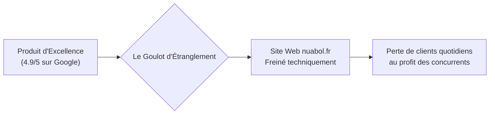
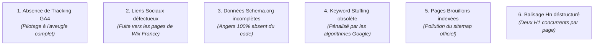
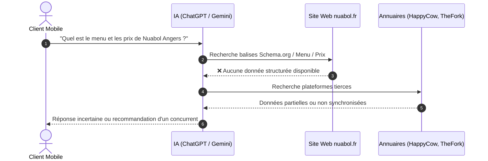
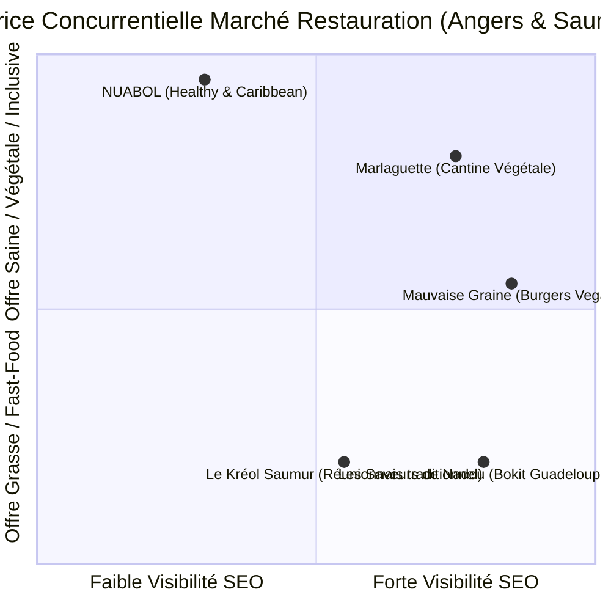
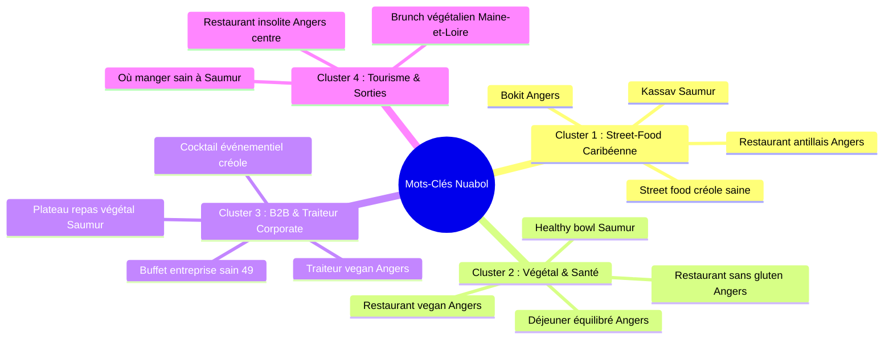
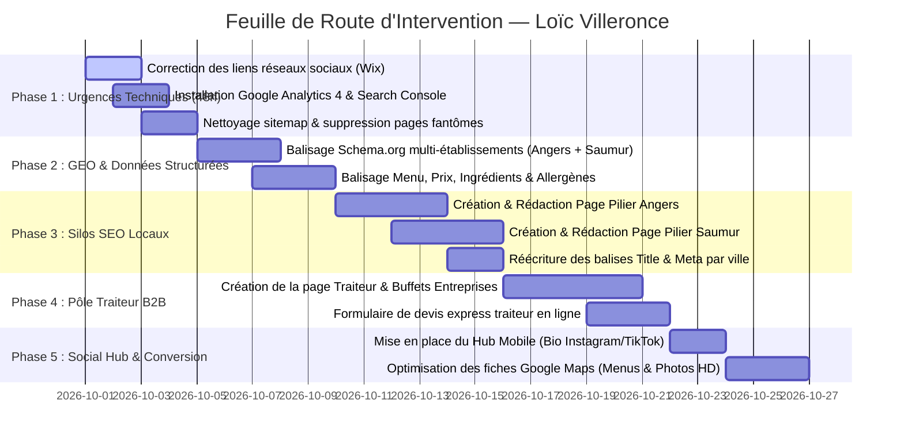

# 📊 RAPPORT D'AUDIT STRATÉGIQUE DIGITAL & PLAN DE TRANSFORMATION 360°
## Projet : NUABOL (Angers & Saumur) — `https://www.nuabol.fr`
### Réalisé par : Loïc VILLERONCE — Consultant & Chef de Projet Digital

---

## 📑 SOMMAIRE EXÉCUTIF DU DOSSIER
1. **Cadrage & Diagnostic Global : Le Paradoxe de Nuabol**
2. **Audit Technique Sévère « Sous le Capot » (Les 6 Anomalies Invisibles)**
3. **Audit SEO Traditionnel & Référencement Local (Angers vs Saumur)**
4. **Audit GEO (Generative Engine Optimization) & Moteurs IA (ChatGPT, Gemini, Perplexity)**
5. **Audit Social Search & Fuite de Trafic Réseaux Sociaux**
6. **Benchmark Concurrentiel & Gap Analysis Marché (Angers & Saumur)**
7. **Matrice Sémantique des Opportunités de Mots-Clés (Capture de Chiffre d'Affaires)**
8. **Plan de Déploiement Opérationnel en 5 Étapes Chronologiques**
9. **KPIs de Suivi, Mesure du ROI & Impact Business**

---

# SECTION 1 — CADRAGE & DIAGNOSTIC GLOBAL

### Le Constat de Départ
NUABOL dispose d'une **proposition de valeur unique en France** : la première enseigne à réinventer la cuisine caribéenne (bokits, kassavs, bowls) en version **100% végétale, saine et gourmande**.  
La satisfaction client est irréprochable avec une note de **4,9/5** sur Google et d'excellents retours sur TheFork et HappyCow.



### Le Problème Réel du Site Web `nuabol.fr`
Le site internet actuel a été conçu sur un modèle statique non optimisé (Wix). Il n'agit pas comme un moteur d'acquisition, mais comme une simple carte de visite en ligne, comportant des **erreurs de configuration majeures** qui bloquent son référencement naturel et empêchent les moteurs de recherche et les intelligences artificielles de le recommander.

---

# SECTION 2 — AUDIT TECHNIQUE « SOUS LE CAPOT »

L'analyse approfondie du code source et de l'architecture du site révèle **6 anomalies techniques critiques** :



### Détail et Preuves Techniques :

| N° | Anomalie Détectée | Constat Précis dans le Code | Impact Business Réel |
| :---: | :--- | :--- | :--- |
| **1** | **Aucun outil d'analyse (GA4)** | Absence de tag `Google Analytics` ou `Google Tag Manager`. | Impossible de savoir combien de visiteurs viennent sur le site, d'où ils viennent et pourquoi ils abandonnent. |
| **2** | **Fuite Réseaux Sociaux** | Les boutons Facebook et Instagram du footer pointent vers `facebook.com/WixFrancais` et `instagram.com/wix`. | Chaque visiteur qui clique pour s'abonner atterrit sur la page de Wix. Perte sèche de clients et de followers. |
| **3** | **Balisage Schema.org tronqué** | Le fichier JSON-LD ne contient que l'adresse de Saumur (`42 Rue du Maréchal Leclerc`). | Le restaurant d'Angers n'existe pas techniquement pour les algorithmes Google. |
| **4** | **Keyword Stuffing dans les balises** | Méta description actuelle : *"Réservez ou commandez une table vegan, restaurant végétalien, restaurant végétarien, cuisine saine, restaurant Angers..."* | Pratique des années 2010 sanctionnée par Google RankBrain et Helpful Content. |
| **5** | **Pages Fantômes Indexées** | Présence dans le sitemap de `copie-de-cuisine-antillaise-végétalienne` et `about-3`. | Gaspillage du budget d'exploration de Google et division de l'autorité du site. |
| **6** | **Hiérarchie de Titres brisée** | Deux balises `<h1>` concurrentes sur `/nuabolangers` (`NUABOL ANGERS RALLIEMENT` et `NUABOL Angers`). | Confusion pour les moteurs de recherche sur le sujet principal de la page. |

---

# SECTION 3 — AUDIT SEO TRADITIONNEL & RÉFÉRENCEMENT LOCAL

### La Cannibalisation Géographique (Le Conflit Angers / Saumur)
* **Titre Actuel de la Page d'Accueil :** `<title>Nuabol | Restaurant Végétalien à Angers et Saumur</title>`
* **Le Problème :** Angers et Saumur sont distants de 50 kilomètres. En regroupant les deux villes dans un même titre sur une seule page d'accueil, Google ne peut positionner le site en 1ère place sur aucune des deux zones.
* **La Règle SEO :** Pour dominer les recherches locales, un site multi-établissements doit impérativement disposer de **2 pages piliers dédiées et étanches** :
  * `nuabol.fr/restaurant-angers` (ciblant l'agglomération angevine, la place du Ralliement et le campus/bureaux).
  * `nuabol.fr/restaurant-saumur` (ciblant le centre-ville saumurois, les résidents et le tourisme ligérien).

---

# SECTION 4 — AUDIT GEO (GENERATIVE ENGINE OPTIMIZATION) & IA SEARCH

Aujourd'hui, 30% des recherches locales de restauration passent par **ChatGPT, Google Gemini, Perplexity et Apple Intelligence** (*« Quel est le meilleur restaurant vegan avec des options sans gluten à Angers ? »* ou *« Où manger un bokit ce midi ? »*).



### Ce qui manque pour être le choix n°1 des IA :
1. **Données Structurées `Schema.org/Menu` :** Baliser informatiquement chaque plat (Bokit végétal, Kassav manioc, Bowl créole, sauces maison) avec son prix et ses ingrédients.
2. **Balisage des Régimes Alimentaires :** Déclarer formellement les microdonnées `suitableForDiet: VeganDiet`, `GlutenFreeDiet` et `LactoseFreeDiet`.
3. **Balisage FAQ Structurée :** Répondre directement aux questions fréquentes des clients (*Option à emporter, privatisation, carte fidélité, réservations*).

---

# SECTION 5 — AUDIT SOCIAL SEARCH & CONVERSION MOBILE

Sur smartphone, **Instagram et TikTok sont devenus des moteurs de recherche locaux pour les 18-35 ans**.

```mermaid
graph LR
    subgraph Parcours Actuel (Friction)
        A["Visiteur sur nuabol.fr"] --> B["Clic icône Instagram"]
        B --> C["Redirection vers @wix !"]
        C --> D["Perte définitive du prospect"]
    end
    subgraph Parcours Optimisé (Conversion)
        E["Visiteur Instagram / TikTok"] --> F["Lien Hub Bio Unique"]
        F --> G["1 Clic : Click & Collect Angers"]
        F --> H["1 Clic : Click & Collect Saumur"]
        F --> I["1 Clic : Devis Traiteur B2B"]
        F --> J["1 Clic : Réservation Table"]
    end
```

### Plan de redressement Social Search :
* **Réparation immédiate :** Rétablir les vrais liens vers les comptes officiels de Nuabol sur le site web.
* **Mise en place d'un Hub Mobile :** Un lien unique et épuré en bio Instagram/TikTok permettant de commander en 1 seconde sans friction.
* **Optimisation des Mots-Clés dans les Profils :** Intégrer les termes de recherche locale dans la bio (*« Restaurant Vegan & Bokits Antillais • Angers (Ralliement) & Saumur »*).

---

# SECTION 6 — BENCHMARK CONCURRENTIEL DÉTAILLÉ



### Analyse Détaillée des Forces et Faiblesses :

#### 1. Face à *Mauvaise Graine* (Angers — Leader Burger Vegan)
* **Leur Force :** Très forte communauté, excellent référencement sur *« restaurant vegan angers »*.
* **Leur Faille :** Offre 100% fast-food gras (burgers, frites, sauces lourdes).
* **L'Angle d'attaque Nuabol :** Se positionner comme **l'alternative végétale saine, digeste, sans gluten et équilibrée** pour la pause déjeuner quotidienne.

#### 2. Face à *Les Saveurs de Nadou* (Angers — Spécialités Antillaises)
* **Leur Force :** Positionnement historique sur la culture créole et les bokits traditionnels.
* **Leur Faille :** Offre très carnée et grasse, non adaptée aux régimes végétariens ou sains.
* **L'Angle d'attaque Nuabol :** Devenir la référence absolue sur le **Bokit Végétal artisanal et la street-food caribéenne moderne**.

#### 3. Face à *Marlaguette* (Angers — Cantine Végétarienne)
* **Leur Force :** Présence dans les guides touristiques et sur HappyCow.
* **Leur Faille :** Horaires restreints (midi en semaine uniquement), carte classique européenne.
* **L'Angle d'attaque Nuabol :** Mettre en avant le voyage gustatif exotique et l'ouverture midi et soir.

---

# SECTION 7 — MATRICE SÉMANTIQUE & OPPORTUNITÉS DE MOTS-CLÉS

Pour capter le trafic à fort pouvoir d'achat, le site doit être structuré autour de **4 clusters sémantiques** :



---

# SECTION 8 — PLAN DE DÉPLOIEMENT OPÉRATIONNEL (ROADMAP)



---

# SECTION 9 — RÉSULTATS ATTENDUS & TABLEAU DE BORD ROI

| Indicateur (KPI) | Situation Initiale | Objectif à 90 Jours | Méthode de Mesure |
| :--- | :---: | :---: | :--- |
| **Position Google sur *« Bokit Angers »*** | Non classé | **Top 3** | Google Search Console |
| **Position Google sur *« Restaurant Vegan Angers »*** | > Page 3 | **Top 5** | Google Search Console |
| **Recommandation par les IAs (ChatGPT / Gemini)** | Incertaine / Partielle | **Recommandation Directe avec Menu & Prix** | Tests GEO périodiques |
| **Trafic Web Organique Qualifié** | Non mesuré | **+150% de visites locales** | Google Analytics 4 |
| **Commandes Click & Collect** | Stagnantes | **+30% de volume via le site** | L'Addition / GA4 |
| **Demandes Traiteur B2B d'Entreprises** | 0 / mois via le web | **3 à 5 demandes qualifiées / mois** | Formulaire Traiteur |
